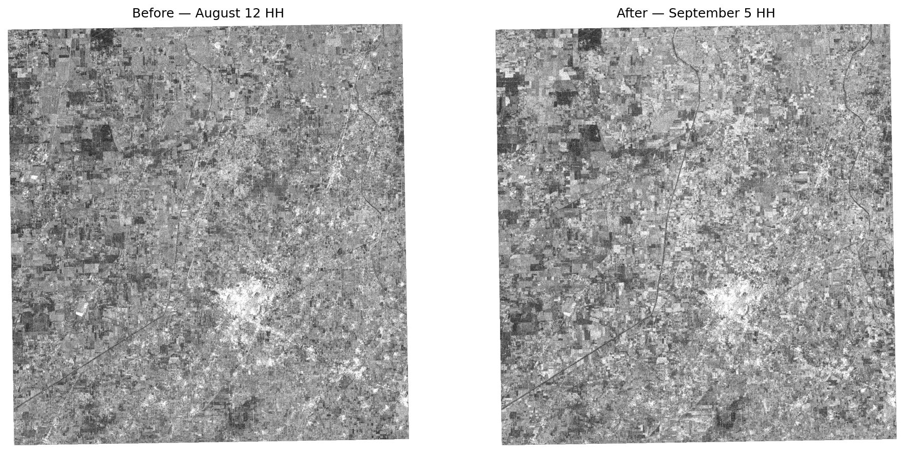
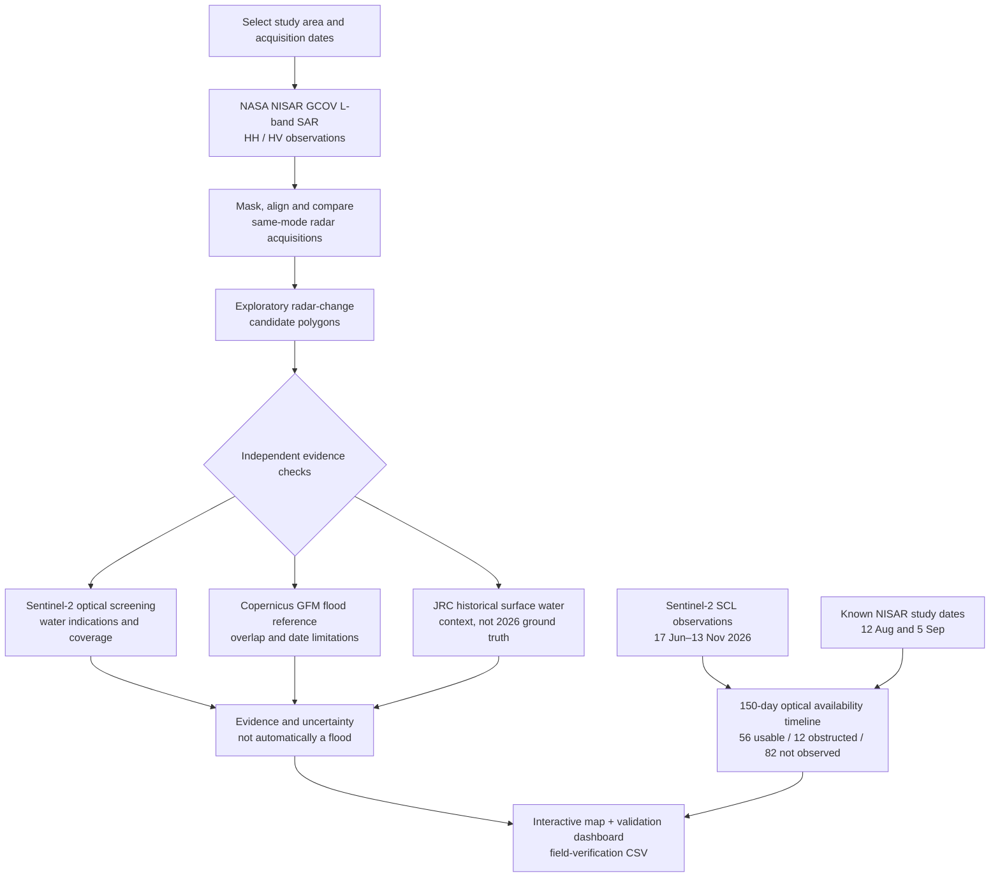
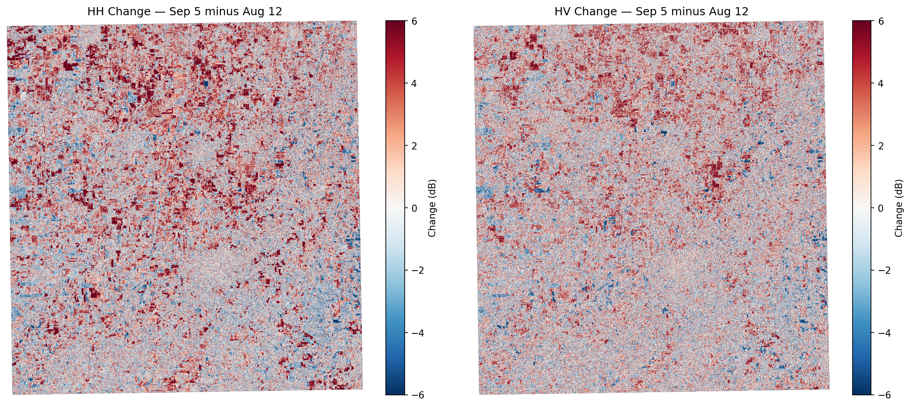
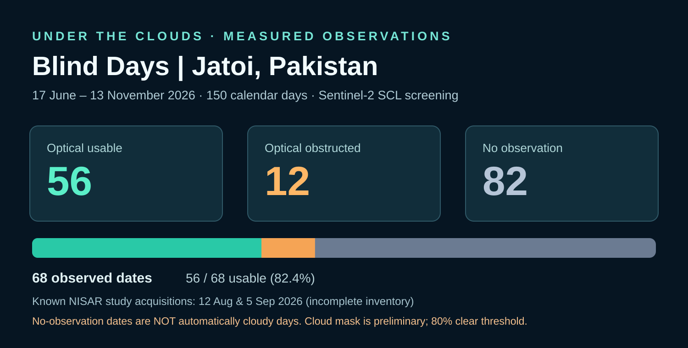
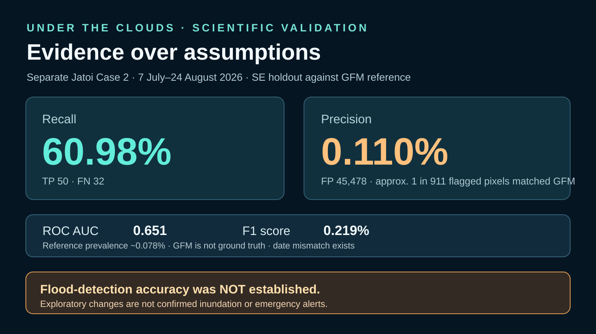
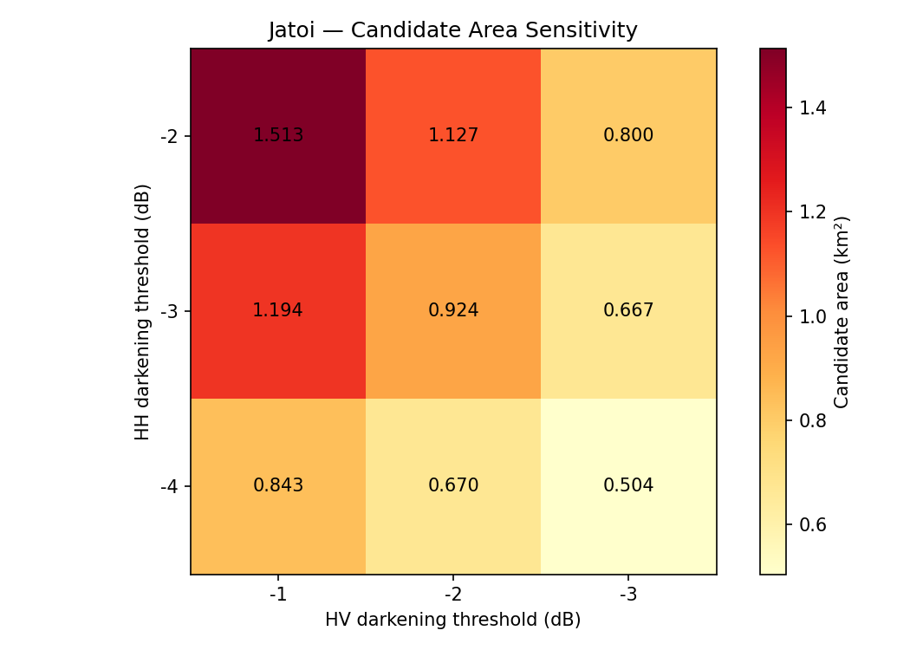

# Under the Clouds ☁️🛰️

**NASA Space Apps Challenge 2026 · Dancing with the SARs**  
**An evidence-first NISAR radar-change explorer for Jatoi and Muzaffargarh, Pakistan**

> **Research demonstration, not a confirmed flood map or operational flood alert.** A radar change is a candidate for investigation—not proof of flooding.

[**Interactive dashboard**](https://eemanefatimaawan567-glitch.github.io/under-the-clouds/) · [**Visual Earth-observation story**](https://eemanefatimaawan567-glitch.github.io/under-the-clouds/story.html) · [**Focused Jatoi evidence**](https://eemanefatimaawan567-glitch.github.io/under-the-clouds/#focused-jatoi) · [Methodology](METHOD.md) · [30-second demo script](DEMO_SCRIPT_30_SECONDS.md)

## Project overview

Monsoon clouds can limit optical Earth observation. **Under the Clouds** combines NASA–ISRO **NISAR L-band SAR observations** with optical and independent flood-reference checks to help people explore where the surface changed, whether optical imagery was available, and what the evidence does—and does not—support. The bilingual (English/Urdu) site shows exploratory candidates in **Jatoi** and a separate **Muzaffargarh** study, with transparent validation and an exportable field-verification list.

<a href="screenshots/homepage.png"></a>

**High-resolution research image:** [Jatoi NISAR observation comparison](assets/jatoi_before_after.png)



## Two distinct Jatoi analyses — keep these numbers separate

The repository now presents two **different geographic/processing footprints**, not two versions of the same flood area:

| | Earlier interactive-map study | New focused Jatoi study |
|---|---|---|
| Role | Existing map and earlier validation tabs | Separate evidence-first analysis and NASA-style story |
| Exploratory clusters | **290** | **125** |
| Candidate pixels | **5,679** | **1,753** |
| Radar-change candidate area | ~0.568 km² | **0.1753 km² (17.53 ha)** |
| Reference comparison | Earlier 27 Aug GFM / 4 Sep limited-footprint checks, reported in original tabs | **4 Sep 2026 Copernicus GFM**, compared with 5 Sep NISAR |
| Scientific interpretation | Unconfirmed surface-change candidates | Unconfirmed surface-change candidates; **5.76% overlap vs 4.31% reference prevalence (≈1.34× baseline)** |

**Do not sum, substitute or merge these values.** The new focused analysis uses NISAR track 164 / frame 73, original HH/HV GCOV images from **12 August** and **5 September 2026**, aligned to a 10 m grid, with an approximate target window **70.75–70.82°E / 29.59–29.65°N**.

### Focused Jatoi independent GFM evidence (4 September 2026)

| Audit item | Measured result |
|---|---:|
| Original NISAR radar-change candidates | **1,753 pixels** |
| Candidates with GFM reference coverage | **1,737 (99.09%)** |
| Candidates overlapping GFM-mapped flood | **100** |
| Covered candidates without mapped flood overlap | **1,637** |
| Candidates lacking GFM coverage | **16** |
| Flood overlap / GFM-covered candidates | **5.76%** |
| GFM flood prevalence across reference-covered study pixels | **19,918 / 462,341 = 4.31%** |
| Enrichment over prevalence (lift) | **5.76% / 4.31% ≈ 1.34×** |
| Readable GFM observations from retrieved 500-item STAC sample | **100** |
| Duplicate observations removed by acquisition time + identical raster | **98** |
| Unique readable observations in that sample | **2** |

The 5.76% candidate overlap is only modestly above the **4.31% chance-prevalence baseline** (lift ≈ **1.34×**). This is a descriptive, non-spatial prevalence comparison, **not** evidence of strong skill, statistical significance, causal flooding, flood confirmation, or a flood-classifier precision/recall/F1 score. Spatial autocorrelation and date mismatch further constrain interpretation. The two GFM observations are dated **4 September 2026**, one day before the 5 September NISAR observation. GFM itself is a satellite-derived estimate. A 500-item catalogue result limit is **not proof of exhaustive temporal coverage**. The largest three candidate clusters in this check had no GFM flood overlap; absence of a GFM flag does not rule out flooding at another time or under different conditions.

The focused geographical window was chosen to examine an approximate **Jatoi locality anchor inside a verified NISAR footprint** and was used before the later direct EODC catalogue comparison; it is **not a randomly selected, independent spatial holdout**. The recorded research history should be used to corroborate the precise selection date and any earlier exposure to flood reports. This window-selection limitation matters for generalization.

The [**focused evidence section**](https://eemanefatimaawan567-glitch.github.io/under-the-clouds/#focused-jatoi) visualizes the counts without altering the existing map datasets. [Machine-readable audit summary](data/focused_jatoi_gfm_20260904.json) · [NASA-inspired visual story](story.html). The dedicated GFM/NISAR georeferenced evidence map generated in Colab is **not yet committed to this repository**, so the focused study is not represented as a new interactive map layer.

### Why this presentation is scientific

- **Observed:** radar-backscatter changes and candidate clusters.
- **Independent comparison:** 5.76% overlap versus a 4.31% reference prevalence (lift ≈ 1.34×), a weak observational enrichment—not established detection skill.
- **Not established:** ground-confirmed inundation, field-level crop damage, affected farmers, losses or operational detection accuracy.
- **Agriculture wording:** if cropland is later intersected with candidates, describe it as *cropland within radar-change candidates*, not flood-damaged crops.

## How it works — research workflow



**Reading the flow:** We do **not** train a successful flood classifier or claim that change pixels are inundated. The independent comparisons are used to *challenge* the radar-change interpretation. The Blind Days calendar measures optical-observation availability separately from the spatial candidate screening.

## Website screenshots and full-resolution research figures

**Screenshot provenance:** Existing screenshots were captured before the separate storytelling page and focused-evidence dashboard section were added. Visit the live pages for the latest interface.


The map and homepage are images captured from the working browser demo. For the two text-heavy sections, we also provide **sharp vector evidence panels** drawn directly from the measured results. Those SVG panels are explanatory diagrams, **not browser screenshots**. Open the live demo to inspect the full interactive interface.

> **Image clarity:** Click the vector panels to view them at any zoom without blur. For full interaction, use the [live website](https://eemanefatimaawan567-glitch.github.io/under-the-clouds/).


### 1. Interactive radar-change explorer



<a href="screenshots/explorer.png"></a>

Shows exploratory radar-change overlays on a map. Orange shapes are **not verified flood extent**; reference layers and study boundaries have separate legends.

### 2. Blind Days — optical observation calendar

<a href="screenshots/blind-days-summary.svg"></a>

*Readable vector summary of measured results; not a screenshot. See the [interactive daily calendar](https://eemanefatimaawan567-glitch.github.io/under-the-clouds/#blind-days) for all 150 dates.*

**17 June–13 November 2026 (150 calendar days):** 56 Sentinel-2 optical-usable dates, 12 observed-but-obstructed dates, and 82 dates with no Sentinel-2 observation. Classification uses an **80% AOI coverage / 80% clear-area threshold**, based on Sentinel-2 scene classification (SCL); the cloud-screening results are preliminary. **No observation ≠ cloudy day.** Known NISAR dates in this study: **12 August and 5 September**; this is **not a full acquisition inventory**.

### 3. Evidence checks

<a href="screenshots/validation-summary.svg"></a>

*Readable vector summary of the separate Case 2 validation, not a browser screenshot.*

The Jatoi radar-change candidates were checked against Sentinel-2 optical observations and Copernicus Global Flood Monitoring (GFM), rather than labelled as flooding by default.



### 4. Validation and limitations

For the complete six-rule table and evidence notes, open the [live Validation section](https://eemanefatimaawan567-glitch.github.io/under-the-clouds/#validation) and select **Case 2**. The source data are available in [`data/threshold_validation.json`](data/threshold_validation.json).

A separate Jatoi July–August holdout test had **60.98% recall**, **0.110% precision** and **ROC AUC ≈ 0.651** against a temporally offset GFM reference. These results do **not** justify an operational flood-detection accuracy claim.

## Earlier interactive-map study — key findings

> **Scope:** The figures in this table belong to the earlier 290-cluster study. For the newer focused study, see [Two distinct Jatoi analyses](#two-distinct-jatoi-analyses--keep-these-numbers-separate).


| Measurement | Result | What it means |
|---|---:|---|
| Jatoi stable radar-change clusters | **290** | Exploratory change candidates, not confirmed flooding |
| Candidate pixels | **5,679** | 10 m analysis grid; approximately **0.568 km²** |
| Jatoi candidate pixels screened using Sep 4 Sentinel-2 | **4,759 / 5,679 (83.8%)** | Spatial screening coverage; **not** the Blind Days metric |
| Optical water indications in screened candidate pixels | **0** | No optical confirmation in assessed pixels, not proof of absence |
| Candidate overlap with 27 Aug Copernicus GFM reference | **0** | Date mismatch limits the inference |
| Sentinel-2 calendar: usable / obstructed / no observation | **56 / 12 / 82** | 150-day observation availability and quality screen |
| Separate Case 2 GFM comparison | **60.98% recall / 0.110% precision** | Unreliable as a flood classifier |

## What judges can explore

- Read the [immersive story](story.html) and open the [focused Jatoi GFM evidence](https://eemanefatimaawan567-glitch.github.io/under-the-clouds/#focused-jatoi), which explain the newer 125-cluster study separately from the map.

1. Open **Explore Map**, switch between Jatoi and the **separate exploratory Muzaffargarh case**, and inspect candidate overlays.
2. Open **Blind Days** to explore 150 dated optical-observation states and known NISAR study acquisitions.
3. Open **Validation** to see mismatches, false alarms and explicit uncertainty.
4. Export the **field-verification CSV** for investigating candidate polygon centroids. These points are **not confirmed flood or breach coordinates**.
5. Toggle **English / اردو** to use the bilingual interface.

## Repository layout

```text
under-the-clouds/
├── index.html                  # Static frontend entry point
├── styles.css                  # Responsive interface styles
├── app.js                      # Explorer, evidence and interaction logic
├── calendar.js                 # Blind Days timeline
├── assets/                     # Research imagery used by the website
├── data/                       # GeoJSON, evidence, validation and calendar data
│   ├── jatoi_clusters.geojson
│   ├── muzaffargarh_candidates.geojson
│   ├── calendar.json
│   ├── blind_days_summary.json
│   └── field_verification_candidates.csv
├── screenshots/                # Actual browser recording stills
├── METHOD.md                   # Science methods and limitations
└── README.md
```

## Run locally

No build step or backend is required. From the repository root:

```bash
python3 -m http.server 8000
```

Visit **http://localhost:8000**. Leaflet and online basemap tiles require an internet connection; the derived research data are bundled locally. To publish, configure **GitHub Settings → Pages → Deploy from a branch → main → / (root)**. Test the deployed URL while signed out.

## Sources and scientific provenance

- **NASA / ISRO NISAR L-band GCOV SAR data** — source of HH/HV radar change analysis.
- **Copernicus Sentinel-2** — optical surface and scene-classification screening.
- **Copernicus Global Flood Monitoring (GFM)** — independent radar-derived flood-reference comparison; **not ground truth**.
- **JRC Global Surface Water** — historical water context (1984–2021), **not** 2026 flood confirmation.
- **Leaflet**, **OpenStreetMap contributors** and **Esri** — map user interface and basemaps, with attribution in the app.

Details and caveats: [METHOD.md](METHOD.md). Derived output files are provided for transparency, not a complete archive of every original satellite product or processing notebook. Original data and third-party assets remain subject to their respective licenses and attribution terms.

## Limitations — what we do not claim

- We **do not** claim confirmed flooding, reliable flood forecasts, validated flood extent, or operational alerts.
- Some radar-change candidates may reflect agriculture, moisture, land-cover or processing effects; their causes are **not established**.
- Independent comparison dates do not perfectly align with the NISAR acquisitions.
- The Blind Days calendar uses preliminary SCL-based cloud masks; no-observation days should not be described as cloudy days.
- The two known Jatoi NISAR study dates do not constitute a complete NISAR coverage inventory.

## License, AI disclosure and acknowledgments

The team's original repository code may be shared under the included **MIT License** (`LICENSE`) if the team owns or is authorized to license all included code. This license **does not relicense** NASA, Copernicus, JRC, OSM, Esri or other third-party data, tiles and assets; preserve each source's attribution and permissions.

**AI disclosure:** OpenAI **ChatGPT** and Anthropic **Claude** assisted with code drafting/debugging, documentation and scientific-communication framing. The team is responsible for evaluating the generated material and verifying data, calculations and claims. The website's screenshots are captured from an actual browser demo, not AI-generated screenshots. Disclose any additional generated images, videos or audio in the project submission, with visible watermarking where required by the event.

## NASA Space Apps submission

- Project title: **Under the Clouds**
- Challenge: **Dancing with the SARs** (confirm exact selectable title in the 2026 Project tab)
- Deliverables: a **public live website**, **public repository**, and a **separate demo link**.
- See [DEMO_SCRIPT_30_SECONDS.md](DEMO_SCRIPT_30_SECONDS.md) and [SUBMISSION_CHECKLIST.md](SUBMISSION_CHECKLIST.md).
- Confirm current event requirements in the official portal and submit before the published deadline.

## Evidence-confidence interpretation (new)

The [Evidence Confidence section](https://eemanefatimaawan567-glitch.github.io/under-the-clouds/#evidence-confidence) now explains three *categorical evidence states*: **supported by reference**, **unconfirmed radar change**, and **insufficient evidence**. These labels describe evidence availability and agreement, **not predicted flood probabilities**. Existing Jatoi candidates remain unconfirmed; no individual polygon is relabelled as a proven flood.

### Additional regional flood-reference experiment (Muzaffargarh, exploratory)

A fixed dual-polarization rule, **HH darkening ≤ −2 dB AND HV darkening ≤ −2 dB**, was compared against a separate July reference (NISAR 12→24 July 2026; GFM 22 July 2026). In the reported evaluation area: **800,728** eligible pixels; **1,571** GFM flood-reference pixels; **TP 135, FP 52,638, FN 1,436, TN 746,519**; **precision 0.256%, recall 8.593%, F1 0.497%**. This was an additional date-pair test of the fixed rule and is **not a validated flood detector**. The GFM reference predates the latter NISAR image by two days; SAR products and GFM are not field ground truth.

In a separate August exploratory experiment (NISAR 17→29 August, GFM 27 August), the HH/HV dual-darkening rule obtained TP 30, FP 6,952, FN 137, TN 192,861 (0.430% precision / 17.96% recall). Restricting GFM comparison to areas outside its exclusion mask and normal reference-water mask changed the evaluation domain to 148,026 pixels and gave TP 30, FP 5,360, FN 137, TN 142,499 (0.557% precision / 17.96% recall). This is a **different evaluation population, not a model accuracy improvement**. GFM advisory categories showed differing results, so they must not be silently discarded.

These regional experiments are **not the data underlying the 172 displayed Muzaffargarh polygons**, and should not be mistaken for per-feature validation. No emergency decisions should be based on these maps.


## NEW — Corrected-scale NISAR HH change research (15 November 2026)

A **separate focused Jatoi research audit** now documents corrected linear-power-to-dB handling, a rule-based change layer, spatial checks, edge-quality concerns, and ten GPS centres for *independent* verification. **Do not combine these numbers with either of the two earlier map footprints.**

- **[Interactive GPS verification map](candidate-review.html)** — 10 interior candidate *centres*, not inundation polygons.
- **[Research results, units correction and limitations](research/JATOI_2026_CHANGE_EVIDENCE.md)** — full reference-based metrics, boundaries and unverified status.
- **[Reproducible Colab notebook](research/Jatoi_Change_Validation_Colab.ipynb)** and [Python source](research/jatoi_change_audit.py) — regenerate rule-based 20 m raster from the team's original Drive GeoTIFFs.
- **[GPS CSV](data/jatoi_interior_change_candidates_2026.csv)** — user-generated centroid targets.

The rule-based experiment generated **14,034 post-HH-dark-only cells**, **2,503 HH-dark-plus-≥3dB-decrease candidate cells** and **941 JRC-occurrence-excluded cells** on its focused radar-valid grid. These are **not confirmed floods** and are not yet hosted as an exact raster overlay because the raster remains in Colab/Drive. In 2 km spatial reference checks with the 25% historical-occurrence exclusion, unrestricted logistic was **slightly** stronger than two-stage gated logistic at the 5% training-budget setting; no model has been field-validated or independently tested on a separate flood event.

